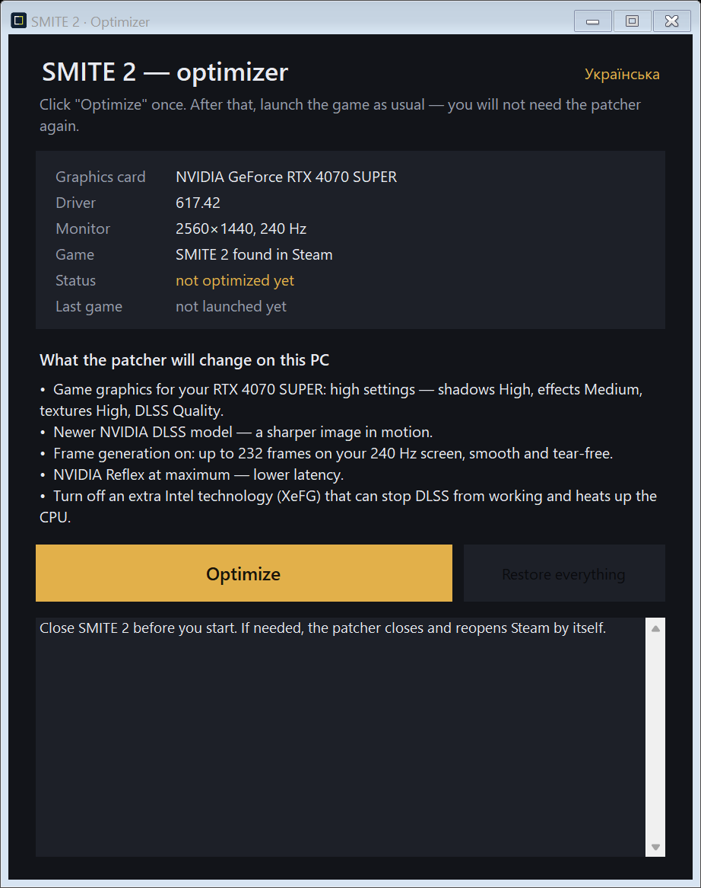
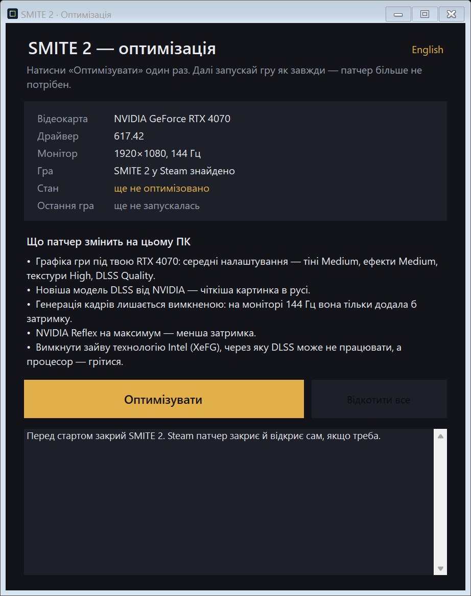

# SMITE 2 Patcher — lag & freeze fix

**Fix SMITE 2 lag, freezes and FPS drops on NVIDIA RTX in one click.** The patcher detects your graphics card, monitor and driver, then sets up the NVIDIA driver, Steam and the game's own graphics for that exact machine. After that you just play: no launcher, nothing running in the background.

[⬇ Download the latest release](https://github.com/RiseFox/smite2-patcher/releases/latest) · [Українською](README.uk.md)

<p align="center">
  
  
</p>

- **Fixes the real causes of lag and freezes.** Intel XeFG stealing the frames DLSS should show, uneven frame pacing with frame generation, settings too heavy for your card. [See exactly what gets fixed.](#lag--freeze-fix-what-gets-fixed)
- **Built from evidence, not guesswork.** Every setting comes from reading SMITE 2's own logs and save files. Tweaks the game silently ignores are not in here.
- **Fits your PC.** An RTX 3060 on a 75 Hz screen, a 4070 on 144 Hz and a 4070 SUPER on 240 Hz each get a different, sensible setup.
- **Safe.** The patcher changes no game files, injects nothing and swaps no DLLs. Everything is backed up, and **Restore everything** puts it back byte for byte.
- **Easy to check.** After one match the patcher reads the game log and shows whether DLSS actually ran on your NVIDIA GPU.
- **Tiny.** About 180 KB and no installer. It runs on stock Windows 10/11, so you can send it to a friend over Discord.
- **Ukrainian and English.** The language follows Windows, and an EN / UA switch sits in the top corner.

---

## Lag & freeze fix: what gets fixed

An honest list. Some freezes the patcher fixes for you, some need one setting or habit, and two can only be fixed by the game's developers.

| You notice | Cause | Fix |
|---|---|---|
| Stutter and FPS drops although the GPU is strong; DLSS frame generation "on" but nothing changes | Intel XeFG takes over the swap chain, so DLSS never presents the frames and the CPU works harder | ✅ **Automatic.** Steam launch option `-XeFGOverrideSwapChainDisabled` |
| Uneven motion or tearing with frame generation, FPS far above the refresh rate | Generated frames run past what the monitor can show | ✅ **Automatic.** Driver cap at refresh × 0.97 together with FG 2X (240 Hz → 232) |
| FPS drops in team fights | Shadows, effects and shading too heavy for the card | ✅ **Automatic.** In-game preset matched to your GPU, laptop or desktop, and VRAM |
| Tweaks from guides do nothing | The game ignores `Engine.ini`, `Scalability.ini`, `-ExecCmds=` and `-ini:` overrides | ✅ **Automatic.** Only routes the game really reads, old leftovers removed |
| 0.2–0.6 s freeze after Alt-Tab or a click on the second monitor | Frame generation is rebuilt on every focus change | ⚙️ **One setting.** *Lock Cursor to Window: Locked*, and no Alt-Tab during a match |
| Multi-second freeze in god select after a game or driver update | Shaders compile the first time each god and skin loads | ⚙️ **Habit.** Play one practice match after updates; never clear the NVIDIA shader cache |
| FPS drops that build up during a long session on a laptop or mini PC | The GPU reaches its thermal target and lowers clocks | ⚙️ **Fan curve.** [See the tips](#more-tips-from-the-investigation) |
| Remaining glitches and small hitches | Bugs in the older DLSS files the game ships | ✅ **Automatic.** The driver override loads NVIDIA's own up-to-date DLSS instead. [How to check](#keep-dlss-up-to-date) |
| A short hitch now and then; a pause while a match loads | Font-cache flush (`FontCache flush … 2/1 Textures`) and blocking loads (`FlushAsyncLoading`) | ❌ **Not fixable from outside.** The game ignores every file route for these; only Hi-Rez / Titan Forge can fix them |

---

## Why this exists

SMITE 2 stuttered and dropped frames on an RTX 5080 Laptop GPU that handles other games easily. Weeks of digging through `Hemingway.log`, NVIDIA's driver profile and the game's save files found concrete causes. The usual "tweak guides" miss most of them:

| What we found | What it caused | What the patcher does |
|---|---|---|
| **Intel XeFG hijacked the swap chain.** The log showed `Found a custom swapchain provider: 'FXeFGDXGISwapChainProvider'` even on an NVIDIA GPU. | NVIDIA's DLSS Frame Generation never actually presented frames, and the CPU worked harder. | Adds the Steam launch option `-XeFGOverrideSwapChainDisabled`. The game logs that it obeys it, and NVIDIA Streamline takes over. |
| **The game ignores most classic tweaks.** The current build (UE 5.5.4, OB45) does not load `Saved/Config/Windows/Engine.ini` or `Scalability.ini` (it even deletes the latter). It also ignores `-ini:Engine:` overrides and `-ExecCmds=`. | Launch options such as `t.MaxFPS`, `r.MotionBlurQuality 0` or Lumen switches never applied. With `t.MaxFPS 116` the frame counter in the log still reached 178 FPS. | Uses only routes that really apply: the NVIDIA driver profile, a Steam flag and the game's own settings file. |
| **Graphics live in `HWGameUserSettings.sav`.** It is a GVAS map of menu indices, and the game stores only non-default values. | Editing `GameUserSettings.ini` alone gets overwritten. | Writes the save exactly like the game does. The output was verified **byte for byte** against files the game itself wrote. |
| **The in-game FPS cap is a menu index**: 30, 60, 90, 120, 144, 240. | A cap of 116 is not possible in the game itself. | Uses the driver's *Max Frame Rate* together with frame generation (240 Hz → cap 232 → ~116 real frames, steady). |
| **Frame generation is rebuilt on every focus change.** Alt-Tab or a click on a second monitor means `NVSDK_NGX_CreateFeature` on return. | A 170–620 ms freeze each time. | Explains it, and suggests *Lock Cursor to Window: Locked*. |
| **Shader compilation after patches**: `Waited for PSO creation for 3200ms` on the first pick of a god skin. | A multi-second freeze in god select. | Tells you to warm up in a practice match after a game or driver update. It happens once per skin, then the driver cache handles it. |

---

## What it does on your PC

The patcher looks at the machine it runs on: GPU name, laptop or desktop, video memory, monitor resolution and refresh rate, NVIDIA driver version, Steam and the game. From that it builds a plan and shows it in plain words before you click.

### 1. NVIDIA driver profile (the SMITE 2 profile only)

| Setting | Value | When |
|---|---|---|
| DLSS Super Resolution | The official DLSS override, so the driver uses NVIDIA's own up-to-date DLSS, and **Preset K** (transformer). The DLSS mode stays under the game's control | RTX, driver 572 or newer, and only if no preset is chosen yet. A preset you picked in DLSS Swapper or the NVIDIA App stays |
| DLSS Frame Generation | **2X, fixed** (no 3X/4X latency) | RTX 40/50 and a monitor of **200 Hz or more** |
| Max Frame Rate | refresh × 0.97 (240 Hz → **232**) | only together with frame generation |

**Why frame generation only from 200 Hz:** with FG and the cap, real frames are about half the refresh rate. On 240 Hz that is ~116 real frames and 232 on screen, almost the same real FPS as without FG but twice as smooth. On a 120 Hz or 165 Hz screen it would be only 58 or 80 real frames, while RTX 40/50 cards render roughly 110–160 FPS in SMITE without FG. More latency, no gain. Without FG the patcher sets no cap, because extra frames above the refresh rate still lower input latency.

### 2. In-game graphics, matched to your card

| | Light | Medium | High |
|---|---|---|---|
| **Desktop cards** | 2060, 3050, 3060, 4050, 4060, 5050 | 2070–2080 Ti, 3060 Ti–3070 Ti, 4060 Ti, 4070, 5060, 5060 Ti | 3080 and up, 4070 SUPER/Ti and up, 5070 and up |
| Shadows | Low | Medium | High |
| Effects | Low | Medium | Medium |
| Textures | Medium (High with 10 GB+ VRAM) | High | High |
| Shading | Low | Medium | High |
| View distance | Medium | High | High |
| Foliage / Reflections | Low / Low | Low / Low | Medium / Medium |
| Anti-aliasing quality | Medium | High | High |

Laptop GPUs get one level lighter than the desktop card with the same name. Effects never go above Medium, so abilities stay readable in team fights.

For every card: anti-aliasing **TAA** (DLSS runs on top of it), **NVIDIA Reflex at maximum**, **Max FPS 240** (the highest in-game cap), DLSS Frame Generation on or off by the rule above. Post-processing is set to Low; the game keeps it at Medium anyway.

**DLSS mode follows your screen:**

| Screen | DLSS mode | Internal render |
|---|---|---|
| 1080p | Quality | 1280×720 |
| 1440p | Quality (Balanced on Light cards) | 1707×960 / 1485×835 |
| 4K | Performance | 1920×1080 |

Performance and Ultra Performance on 1080p would render 540p and 360p: blurry, with ghosting, and hardly any extra FPS on a 90–144 Hz screen. You can switch to anything you like in the game menu afterwards; the patcher will not fight you.

### 3. Steam

It adds `-XeFGOverrideSwapChainDisabled` to SMITE 2's launch options for each Steam account that has the game. It also removes leftover `-ini:Engine:…` / `-ExecCmds=…` options, which the game ignores anyway, and keeps everything else. If Steam is open, the patcher asks, closes it gracefully (`steam -shutdown`), edits the config and starts Steam again.

Cards without RTX (GTX) keep Intel XeFG, because it is the only frame generation they have. For them the patcher changes nothing and suggests FSR or XeSS in the game menu.

---

## Check that DLSS really works

Play one match or a practice game, quit, and open the patcher again. The **Last game** row reads the game's own log:

```
18.10 21:17 · NVIDIA ✓ · DLSS ✓ 1920×1080 → 3840×2160, Preset F · Intel XeFG disabled ✓ · FG ✓
```

It shows which GPU the game used, whether DLSS started and at what resolutions, which DLSS model the driver applied, whether Intel XeFG still owned the frames, and whether frame generation ran. On an unpatched install it catches exactly the old problem: `✗ Intel XeFG is taking over the frames`.

---

## Safety

- **No game files change.** Nothing in the Steam game folder is touched. The patcher edits only the NVIDIA driver profile, the game's launch options in Steam, and the game's own settings files, which the game itself writes too.
- **Anti-cheat friendly.** No injection, no DLL replacement, no memory access. Everything is something you could also set by hand in the NVIDIA App, Steam and the game menu.
- **Full backup.** The first run saves the original driver values, the launch options of every Steam account and copies of both game settings files under `%LOCALAPPDATA%\SMITE2-Patcher`. **Restore everything** puts them back byte for byte.
- **Careful writing.** Steam's `localconfig.vdf` is edited in place, so the rest of the file stays exactly as it was. The game save is re-parsed after every write. If its format ever changes after a game update, the patcher leaves it alone and says so.
- **Tested.** The automated end-to-end test (`--e2e-test`) runs apply → apply again → monitor change → restore against a throwaway driver profile and copies of real Steam and game files. It also checks that a DLSS preset picked in DLSS Swapper survives both apply and restore. All 21 checks pass, and restored files are identical to the originals.

This is a community tool. It is not affiliated with Hi-Rez Studios, Titan Forge Games or NVIDIA.

---

## Download and use

1. Download `SMITE2-Patcher-<version>.zip` from [Releases](https://github.com/RiseFox/smite2-patcher/releases/latest) and unzip it anywhere. Keep `SMITE2-Patcher.exe` and `SmitePatchNv.dll` together.
2. Close SMITE 2.
3. Run `SMITE2-Patcher.exe` and click **Optimize**. If Windows shows *"Windows protected your PC"*, click *More info → Run anyway* (the EXE is not code-signed).
4. In the game menu set **Display → VSync Enabled: Off** and **Lock Cursor to Window: Locked**. That's it.

Run it again only when you change your monitor or GPU, or when an NVIDIA driver update reset the profile (the window then says *not optimized yet*).

**Requirements:** Windows 10 1903+ or Windows 11 (.NET Framework 4.8 is built in), an NVIDIA GPU, and SMITE 2 on Steam. DLSS overrides need RTX 20 series or newer and driver 572+. Frame generation needs RTX 40/50.

---

## Keep DLSS up to date

Newer DLSS versions fix bugs of their own, so run the newest one. **With the patcher, NVIDIA does this for you.** The patcher turns on the driver's official DLSS override. With the override on, SMITE 2 stops using the DLSS files that ship with the game. The driver loads its own copy from `C:\ProgramData\NVIDIA\NGX\models` instead, and NVIDIA keeps that copy updated. The game's own log shows it:

```
Built with APP_NAME = nvapp_override
Loaded from path "C:\ProgramData\NVIDIA\NGX\models\dlss\versions\20318480\files/160_E658700.bin"
feature dlss snippet: …\160_E658700.bin version: 310.9.16
```

The plan in the patcher window shows the DLSS version NVIDIA has on your PC. After a match, the **Last game** row shows which DLSS really ran and where it came from: `310.9.16 via NVIDIA` or `from game files`.

| DLSS part | Driver override | Where SMITE 2 loads it from |
|---|---|---|
| Super Resolution | on (patcher) | NVIDIA's store, always the version NVIDIA last downloaded |
| Frame Generation | on (patcher, when FG is part of the plan) | NVIDIA's store |
| Ray Reconstruction | off: the NVIDIA App lists RR as *Unsupported* for SMITE 2 | the game folder (`nvngx_dlssd.dll`). The game loads it but does not render with it |

So while the override is on, swapping the Super Resolution and Frame Generation DLLs in the game folder does not change what runs. The **Last game** row is the quick way to check.

### Where DLSS Swapper still helps

**[DLSS Swapper](https://github.com/beeradmoore/dlss-swapper)** is still a great companion:

- **Presets.** Presets from DLSS Swapper or the NVIDIA App (*Graphics → SMITE 2 → DLSS Override – Model Presets → Custom*) land in the same NVIDIA profile the patcher uses. The patcher (1.2.1 and newer) keeps a preset you chose instead of setting K, and *Restore everything* leaves it in place.
- **PCs without the override.** With no patcher or a driver older than 572, the game uses its own DLSS files, and DLSS Swapper is how you update them.
- **Seeing versions** of every DLSS file a game has.

**Test presets yourself.** What looks and plays best depends on your card and screen. Change one preset, play a practice match, compare. **The author's setup** (RTX 5080 Laptop GPU, 4K 240 Hz, DLSS 310.9.16):

| DLSS part | Preset |
|---|---|
| Super Resolution | **F** |
| Frame Generation | **C** |
| Ray Reconstruction | not used: *Unsupported* for SMITE 2 in the NVIDIA App |

On this PC preset F gave more FPS and felt smoother than K. K is the newer transformer model: sharper in motion, but heavier on the GPU. Try both.

The patcher itself never swaps DLLs. DLSS Swapper replaces files in the game folder, and SMITE 2 uses Easy Anti-Cheat. The author has played with swapped DLLs without any problems, but that step is your call.

## More tips from the investigation

- **Second monitor?** In borderless mode a click on the other screen takes focus away, and frame generation then restarts with a 0.2–0.6 s freeze. Set *Lock Cursor to Window: Locked*.
- **Do not Alt-Tab during a match** for the same reason.
- **After a game or driver update**, play a practice match first. The first time each god and skin loads, its shaders compile, and this can freeze god select for seconds. Afterwards the NVIDIA shader cache handles it, so never clear that cache.
- **Mini PCs and laptops:** check your fan curve. A GPU that reaches its 87 °C thermal target lowers its clocks, and that shows up as FPS drops. One test PC had its GPU fans capped at 65% from 80 °C up. Raise the curve so the fans are near maximum before the target, for example about 90% at 84 °C.
- **Ultra Performance on 4K?** If a driver override forces Performance, the game still renders at 1080p. The author still sees simpler textures and a few more FPS with the Ultra Performance menu choice, most likely because the game picks lower texture detail for it. If you care about FPS more than texture sharpness, try it.

---

## For developers

```
native/   SmitePatchNv.dll: read/write/delete DWORD settings on the profile that owns an EXE (official NVAPI SDK)
src/      the patcher (C#, .NET Framework 4.8, WinForms)
tools/    smite_hitch_report.py: find stutters in Hemingway.log; smite_settings_dump.py: print the save's settings map
docs/     settings-map.md: every in-game value, verified in the menu
package/  READMEs that go into the ZIP
```

**Build** (Visual Studio C++ tools, CMake 3.24+, .NET SDK 8+):

```powershell
.\build.ps1                      # downloads NVAPI on first build
.\build.ps1 -NvapiSource C:\src\nvapi   # or use a local checkout
```

The result is `release\SMITE2-Patcher-<version>.zip`.

**Diagnostics** (run from a terminal; each writes a report file):

| Command | What it does |
|---|---|
| `SMITE2-Patcher.exe --plan out.txt` | detected PC, the plan, current driver values, pending Steam edits, last game. Read-only. Ask a friend for this file |
| `--simulate out.txt` | plans for a list of typical PCs |
| `--preview "NVIDIA GeForce RTX 4070" 144 1920 1080 out.png` | renders the window as another PC would see it |
| `--check-log Hemingway.log out.txt` | the "Last game" analysis for any log |
| `--selftest-nv out.txt` | write, read and delete on a throwaway driver profile |
| `--e2e-test out.txt` | the full apply/restore cycle on copies of your files; never touches the real profile or Steam |
| `--test-save <folder> out.txt` | checks the save writer against saves the game wrote (bring your own captures) |
| `--lang en` / `--lang uk` | put first to force the language for that run |

How the save works, what every menu index means and how each one was verified is in [docs/settings-map.md](docs/settings-map.md).

## License

MIT, see [LICENSE](LICENSE). NVAPI is © NVIDIA under its MIT license (`LICENSE-NVIDIA-NVAPI.txt` ships in the release). SMITE is a trademark of Hi-Rez Studios.
